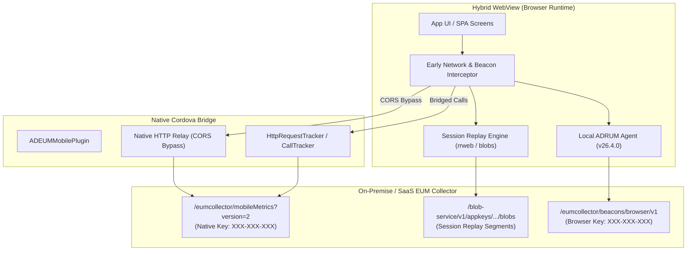
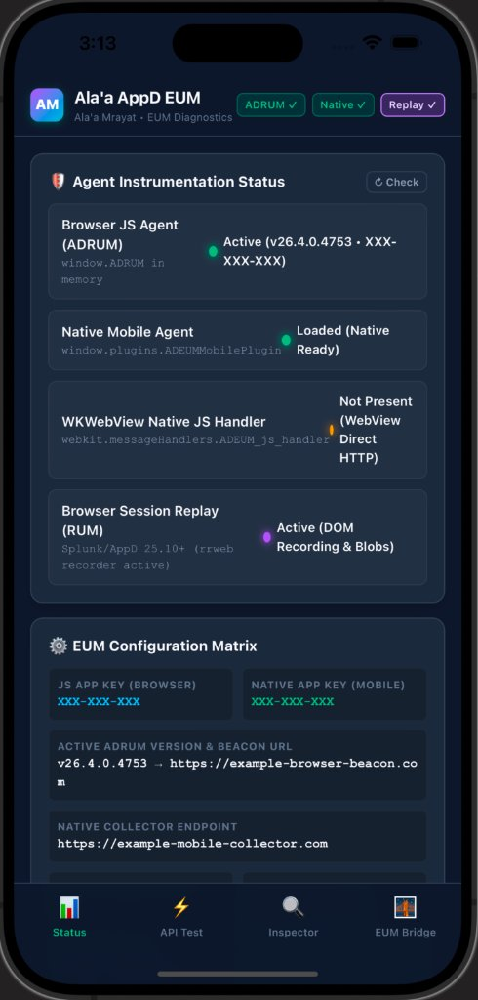
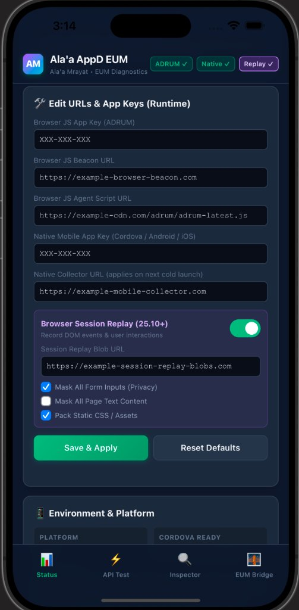
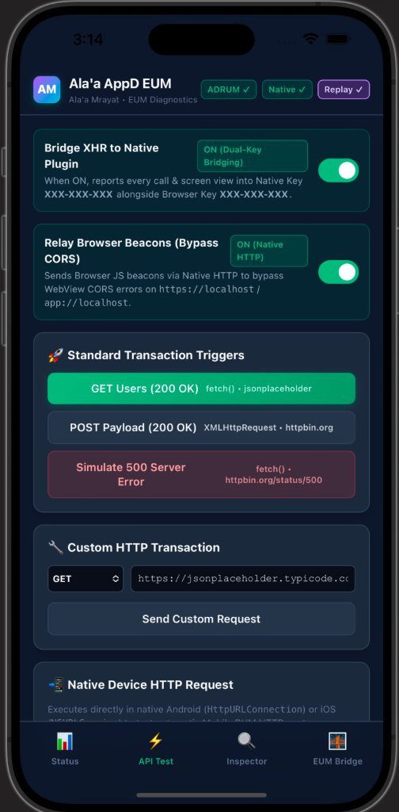
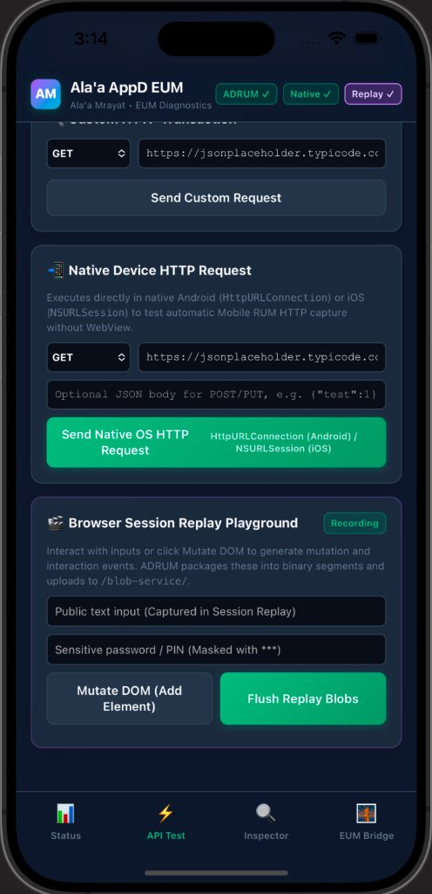
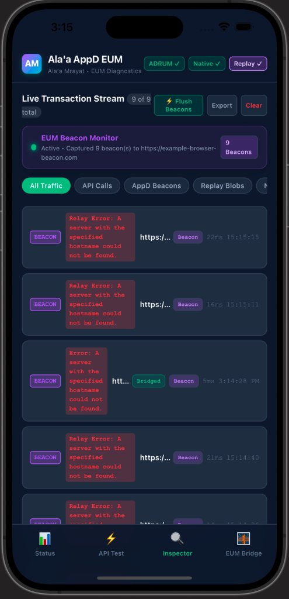

# Ala'a AppD EUM — Dual-Instrumentation Debugger & Session Replay Lab

[](https://cordova.apache.org/)
[](https://help.splunk.com/)
[](LICENSE)
[](https://github.com)

> **Created & Engineered by:** [Ala'a Mrayat](https://github.com/AlaAlmarayat)  
> **Repository:** `https://github.com/AlaAlmarayat/alaa-appd-eum.git`

---

## 🚀 Overview

**Ala'a AppD EUM** is a developer suite and test laboratory for Apache Cordova, Capacitor, and hybrid mobile applications designed to inspect, debug, and validate **AppDynamics / Splunk End-User Monitoring (EUM)** across both **Browser RUM** and **Native Mobile RUM** simultaneously.

### The Problem It Solves
In hybrid mobile architectures, WebView network traffic (`fetch()`, `XMLHttpRequest`) runs in an isolated browser sandbox:
1. **Browser Agent (`ADRUM`)** captures traffic and reports it exclusively to the **Browser App Key**.
2. **Native Mobile Agent (`ADEUMMobilePlugin`)** remains completely blind to WebView network calls unless explicitly bridged.
3. **CORS Restrictions** in modern WebViews (`https://localhost` or `app://localhost`) drop or reject cross-origin beacon calls to corporate on-premise EUM collectors.
4. **Browser Session Replay (25.10+)** requires strict blob-service coordination, asset bundling, and privacy compliance.

**Ala'a AppD EUM** resolves these challenges with zero cold-boot delays, runtime dual-key bridging, native CORS relays, local offline bundling, and an interactive diagnostics suite.

---

## 🛠️ Architecture



---

## 📱 Screenshots & Visual Tour

| 1. Instrumentation Status & Matrix | 2. Runtime Config & Session Replay |
| :---: | :---: |
|  |  |
| **Agent Status & Config Matrix**<br/>Live verification of Browser ADRUM, Native Mobile Agent, and EUM endpoints. | **Runtime Key & Replay Controls**<br/>On-the-fly key updates with localStorage persistence and Session Replay privacy toggles. |

| 3. Dual-Key Bridging & CORS Relay | 4. Native OS HTTP & Replay Lab |
| :---: | :---: |
|  |  |
| **Dual-Key & CORS Relay Lab**<br/>Simultaneous reporting to Browser + Native App Keys, plus native HTTP CORS bypass. | **Native OS HTTP & Replay Playground**<br/>Direct native OS requests (`HttpURLConnection`/`NSURLSession`) and DOM mutation recorder. |

| 5. Live Stream & Beacon Monitor |
| :---: |
|  |
| **Live Stream & Beacon Inspector**<br/>Real-time inspection of correlation headers, payload sizes, durations, and beacon delivery status. |

---

---

## ✨ Key Features

* **⚡ Dual-Key Live Instrumentation**: Toggle dual-key bridging on the fly. Network requests report simultaneously to both the **Browser App Key** and the **Native Mobile App Key**.
* **🎬 Browser Session Replay (Splunk/AppD 25.10+)**: Bundled locally (`session-replay.browser.min.js`) with 0 cold-boot latency. Includes privacy controls (Mask Form Inputs, Mask All Text, Pack Static Assets) and live blob upload tracking.
* **🔁 Native Beacon CORS Relay**: Automatically catches Browser JS beacons blocked by WebView CORS on `https://localhost` and relays them via native HTTP (`HttpURLConnection` / `NSURLSession`).
* **📲 Native Device HTTP Tester**: Dispatches HTTP requests directly from the Android/iOS native layer to verify automatic Mobile RUM bytecode instrumentation.
* **🔍 Live Transaction Stream Inspector**: Full inspection of headers, correlation headers (`adrum_...`, `AppD-Request-Id`, `traceparent`), request/response bodies, durations, and multipart Session Replay blobs.
* **💥 Crash & Exception Lab**: Safely trigger unhandled JavaScript errors or intentional native OS crashes to test crash reporting and breadcrumbs.
* **⚙️ Runtime Config Matrix**: Change App Keys, Beacon URLs, Collector URLs, and Session Replay endpoints on the fly with instant persistence to `localStorage`.

---

## 📋 Project Structure

```
alaa-appd-eum/
├── config.xml                          # Cordova configuration & iOS ATS settings
├── hooks/
│   └── after_prepare/
│       └── patch_appd.js               # Auto-injector for Gradle 8, Android 15 & iOS plists
├── res/
│   ├── icon.png                        # Master 1024x1024 App Icon (AM + AppDynamics)
│   ├── values/
│   │   └── strings.xml                 # Android AppD configuration strings
│   └── xml/
│       └── network_security_config.xml # Android System & User CA trust anchors
├── screenshots/                        # iOS & Android interface gallery preview images
├── www/
│   ├── css/
│   │   └── index.css                   # Modern Cyber Dark Theme Stylesheet
│   ├── js/
│   │   ├── adrum.js                    # Local bundled ADRUM Agent (0 network delay)
│   │   ├── session-replay.browser.min.js # Local bundled Session Replay Engine
│   │   └── index.js                    # SPA Controller, Interceptors & Bridge Engine
│   └── index.html                      # 4-screen diagnostics dashboard
├── platforms/
│   ├── android/                        # Android Platform (AGP 8.7.2, Gradle 8.10.2)
│   └── ios/                            # iOS Platform (Xcode 15/16 workspace)
└── plugins/
    └── appd-plugin-eum-mobile/         # Native Mobile EUM Plugin (Enhanced with Relay & Crash)
```

---

## 💻 Prerequisites

Ensure your development environment meets the following specifications:

| Requirement | Supported Version | Notes |
| :--- | :--- | :--- |
| **macOS** | 14+ (Sonoma / Sequoia) | Apple Silicon (M1/M2/M3/M4) or Intel |
| **Node.js** | 18.x or 20.x | LTS recommended |
| **Java JDK** | OpenJDK 17 | Required for Android Gradle Plugin 8.7.2 |
| **Android SDK** | API Level 34 / 35 / 36 | Android Command-line Tools & Platform-Tools |
| **Xcode** | 15.x or 16.x | Required for iOS builds and simulators |
| **Cordova CLI** | 12.x+ (`npx cordova`) | Included via local devDependencies |

Set the required environment variables in your `~/.zshrc`:
```bash
export JAVA_HOME="$HOME/.jdk-17/Contents/Home"
export ANDROID_HOME="$HOME/Library/Android/sdk"
export DEVELOPER_DIR="/Applications/Xcode.app/Contents/Developer"
export PATH="$JAVA_HOME/bin:$HOME/.gradle-dist/gradle-8.10.2/bin:$HOME/.nodejs/bin:$ANDROID_HOME/cmdline-tools/latest/bin:$ANDROID_HOME/platform-tools:$PATH"
```

---

## 🔨 Build & Installation Guide

### 1. Clone the Repository
```bash
git clone https://github.com/AlaAlmarayat/alaa-appd-eum.git
cd alaa-appd-eum
npm install
```

### 2. Synchronize Assets & Native Platforms
The custom `patch_appd.js` hook automatically verifies and patches native SDK configurations:
```bash
npx cordova prepare
```

### 3. Build & Run on Android
```bash
# Deploy to connected USB device or running emulator:
npx cordova run android --no-telemetry

# Or build debug APK directly:
npx cordova build android
# Output: platforms/android/app/build/outputs/apk/debug/app-debug.apk
```

### 4. Build & Run on iOS
```bash
# Build for iOS Simulator:
xcodebuild -workspace platforms/ios/App.xcworkspace \
           -scheme App \
           -destination 'generic/platform=iOS Simulator' \
           CODE_SIGNING_ALLOWED=NO build -quiet

# Or open in Xcode to run on a physical iPhone:
open platforms/ios/App.xcworkspace
```

---

## ⚙️ Configuration & Key Management

By default, the application is shipped with clean placeholder templates:

```javascript
var defaultCfg = {
    jsAppKey: "XXX-XXX-XXX",
    jsBeaconUrl: "https://example-browser-beacon.com",
    jsCdnUrl: "https://example-cdn.com/adrum/adrum-latest.js",
    nativeAppKey: "XXX-XXX-XXX",
    nativeCollectorUrl: "https://example-mobile-collector.com",
    sessionReplayUrlHttps: "https://example-session-replay-blobs.com",
    sessionReplayEnabled: true
};
```

### How to Point to Your Real AppDynamics Environment
1. Launch the app on your device or emulator.
2. Navigate to the **Status / Configuration** screen.
3. Under **Edit URLs & App Keys (Runtime)**:
   * **Browser JS App Key**: Enter your Web App Key (e.g., `EUM-AAB-AUE`).
   * **Native Mobile App Key**: Enter your Mobile App Key (e.g., `EUM-AAB-AVW`).
   * **Beacon / Collector URLs**: Enter your on-premise EUM server or SaaS endpoint.
4. Click **Save & Apply** (the app updates live and reloads the WebView).
5. To restore sanitized templates at any time, click **Reset Defaults**.

---

## 🚢 Pushing to Your GitHub Repository

To publish this project to your personal or organization GitHub account:

```bash
# 1. Add your GitHub remote:
git remote add origin https://github.com/AlaAlmarayat/alaa-appd-eum.git

# 2. Stage all files:
git add .

# 3. Create initial commit:
git commit -m "feat: initial commit of Ala'a AppD EUM Debugger & Session Replay Lab"

# 4. Push to main:
git branch -M main
git push -u origin main
```

---

## 🩺 Troubleshooting Guide

### 1. `{"command":"disable-agent"}` on Session Replay Uploads
* **Symptom**: Replay blobs send with `HTTP 200`, but server responds with `{"command":"disable-agent"}`.
* **Cause**: Session Replay is not enabled in the Controller UI, or sampling rate is `0%`.
* **Fix**: In Controller UI, go to **User Experience → [Web App] → Configuration → Session Replay** → check **"Enable Session Replay"** and set sampling rate > 0%.

### 2. Events Missing in Controller UI Despite HTTP 200 Beacons
* **Symptom**: Beacons reach on-premise EUM Collector, but graphs in Controller UI remain empty.
* **Fix**: Check `logs/eum-processor.log` on the EUM Server:
  * Verify **Events Service** connection (`http://<events-service-ip>:9080/v1`).
  * Check for Elasticsearch disk watermarks (`cluster_block_exception`).
  * Verify time zone / time range filter in Controller UI (switch to **"Last 24 Hours"**).

### 3. macOS Keychain Code Signing Prompt (`codesign`)
* **Symptom**: System dialog asks for `"login"` keychain password during iOS build.
* **Fix**: Enter your **Mac login password** (not Apple ID password) and click **"Always Allow"**.

---

## 👤 Author & Maintainer

* **Creator & Lead Engineer**: **Ala'a Mrayat**
* **Project**: Ala'a AppD EUM Dual-Instrumentation Debugger
* **Contributions**: Pull requests and issue reports are welcome!

---

## 📄 License

This project is licensed under the [MIT License](LICENSE) — see the LICENSE file for details.
